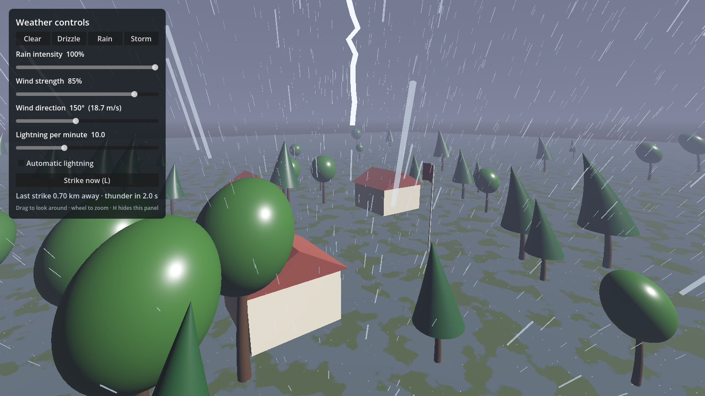
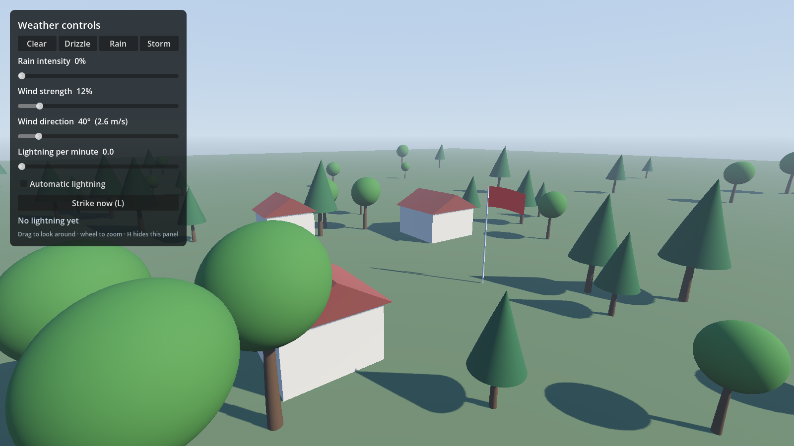
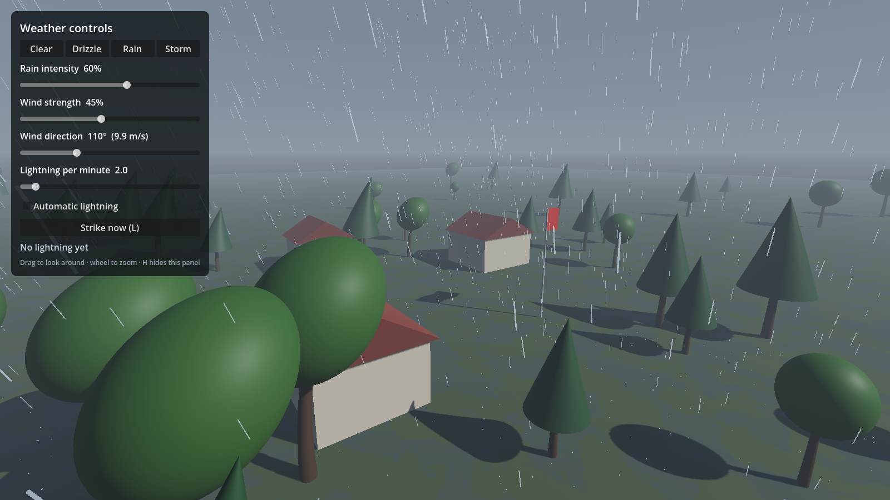

# Godot 4 weather prototype

A technical prototype of an ambient 3D weather environment in Godot 4 (GDScript), built with deliberately simple placeholder assets so the weather systems can be judged on their own.



| Clear | Rain |
|---|---|
|  |  |

## What it does

- **Rain:** up to 9,000 GPU particle streaks around the camera plus ground splashes. Intensity scales smoothly through `amount_ratio` (no particle restarts), and the streaks slant with the wind.
- **Wind:** strength and direction with slow gusts on top, published as a global shader value. Trees bend with height (trunk and canopy together), and the flag turns down-wind and flaps faster as the wind rises.
- **Lightning:** automatic strikes at a configurable rate (exponential gaps, more distant strikes more often) or on demand. Each strike draws a jagged bolt, flashes the sky and sun with brightness scaled by distance, and can re-flicker like a multi-stroke bolt.
- **Thunder with a real delay:** the sound arrives after distance ÷ 343 m/s, measured from the camera. Close strikes get a sharp crack; distant ones are quieter and low-passed into a rumble.
- **Layered audio:** light-rain hiss and heavy-rain roar crossfaded by intensity, a wind layer whose volume and pitch follow the gusting wind, and thunder on its own bus with reverb. All sounds are synthesised at startup, so there are no audio files to license.
- **Environmental reactions:** the ground darkens, turns glossy and grows puddles as it gets wet (and dries slowly afterwards); foliage darkens when wet; the sky, sun and fog go overcast with the rain.
- **Control panel:** presets (Clear, Drizzle, Rain, Storm), sliders for rain, wind strength, wind direction and lightning rate, automatic lightning toggle, a "Strike now" button and a live "thunder in X s" readout. `H` hides the panel, `L` strikes.

## Structure

```
weather/weather.gd            autoload: the single source of truth (values, presets, strike + thunder timing)
systems/rain_system.gd        rain streaks, splashes, ground wetness
systems/wind_system.gd        gusting wind -> global shader value
systems/lightning_system.gd   strike scheduling, bolt, flash
systems/atmosphere_system.gd  sky colour, sun, ambient light, fog
systems/weather_audio.gd      synthesised, layered audio and buses
world/placeholder_world.gd    ground, trees, houses, flag (swap for final art)
ui/control_panel.gd           local controls; only reads/writes the Weather autoload
shaders/                      foliage, ground and flag shaders reading the global wind/wetness
```

Systems never reference each other; they read the `Weather` autoload and its signals (`changed`, `lightning_struck`, `thunder_arrived`). Adding snow, waves or an external controller (OSC, WebSocket, a hardware panel) means adding one node that talks to `Weather`.

## Tested

`WeatherPrototype.exe --headless -- --selftest` (or the same through the editor binary):

```
PASS  thunder 343 m away arrives after 1.0 s
PASS  thunder 3.43 km away arrives after 10 s
PASS  rain is clamped to 0..1
PASS  wind direction wraps to 0..360
PASS  wind 50% toward 90° blows +X at 11 m/s
PASS  Storm preset turns on automatic lightning
PASS  rain particles scale with intensity
PASS  rain + wind + thunder audio layers synthesised
PASS  strike at 34.3 m schedules thunder 0.10 s later
PASS  thunder_arrived fires once with the strike distance
ALL CHECKS PASSED
```

The screenshots above come from `-- --capture=<dir>`, which renders each preset and saves PNGs.

## Run

Download `WeatherPrototype.exe` from Releases (standalone Windows x64, nothing to install), or open the folder in Godot 4.7 and press F5. To export: `godot --headless --export-release "Windows Desktop" builds/WeatherPrototype.exe`.
